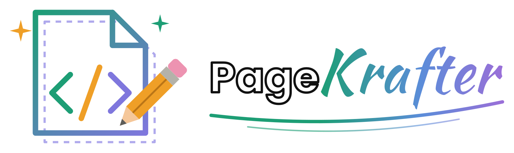

A drag-and-drop page and email builder for Blazor Server.

- **The page is a JSON tree.** That is all you store. HTML is generated from it, so pages stay editable and can be re-rendered when blocks improve.
- **The canvas is an isolated iframe** loaded with `srcdoc`, so your site's CSS applies to the page being edited and the editor's CSS never leaks into it. The editor and canvas talk over `postMessage`.
- **Web and email from the same blocks.** In email mode, blocks render as tables with inline styles.
- **Templates.** Built-in section and page templates (two, three and four columns, sidebars, hero, newsletter and more), plus templates your users save themselves.
- **Your own blocks.** Write a block in C# or as a Razor component, give it fields and child slots, and register it with one line.

## Projects

| Project | Purpose |
| --- | --- |
| `PageKrafter.Core` | Document model, block registry, built-in blocks, templates, HTML rendering and the editing session. No Blazor dependency, so a public site can render pages with only this. |
| `PageKrafter.Components` | The `PageKrafterEditor` Blazor component, the canvas scripts and the extension base classes for Razor blocks and inspector fields. |
| `PageKrafter.Demo` | A Blazor Server app with a page builder, an email builder and two example host blocks (a CMS content zone and a callout). |
| `PageKrafter.Tests` | xUnit tests. |

Run the demo with `dotnet run --project PageKrafter.Demo` and open http://localhost:5180.

## Getting started

Register the services:

```csharp
builder.Services.AddRazorComponents().AddInteractiveServerComponents();
builder.Services.AddPageKrafter(options =>
{
    // Your site's stylesheet, loaded into the canvas so pages look the same while editing.
    options.CanvasStyles.Add("css/site.css");
});
```

Add the editor stylesheet to `App.razor`:

```html
<link rel="stylesheet" href="@Assets["_content/PageKrafter.Components/pagekrafter.css"]" />
```

Use the editor in an interactive page:

```razor
<PageKrafterEditor @bind-Value="page.Json" OnSave="SaveAsync" />

@code {
    private async Task SaveAsync(PageDocument document)
    {
        page.Json = PageKrafterJson.Serialize(document);
        page.Html = await Renderer.RenderAsync(document);   // optional: store ready-made HTML too
        await db.SaveChangesAsync();
    }
}
```

`Value` is the JSON string. An empty value starts a new page. Set `Mode="DocumentMode.Email"` for an email. Other parameters:

- `Height` sets the editor height.
- `AllowedBlocks` restricts the palette.
- `ShowTemplates` hides or shows the templates tab.
- `ToolbarContent` adds your own toolbar buttons.

To show a page, either store the HTML from `PageRenderer.RenderAsync` when saving, or keep only the JSON and render it at request time. Use `PageRenderer.RenderDocumentAsync` for a complete HTML document, which is what an email send needs.

### Editor features

- Drag blocks, section templates and layers. Drop near a container's edge to place a block beside it rather than inside.
- Click a palette item to add it next to the selected block.
- Double-click headings, text and buttons to edit them on the page. Text blocks get a small formatting toolbar.
- Inspector with grouped content, style and advanced fields. Every block gets padding, margin, colours, alignment, radius, CSS classes, an anchor id and responsive visibility.
- Layers tree, undo and redo (edits to the same field are merged), desktop, tablet and mobile widths, preview mode and an HTML export dialog.
- Keyboard shortcuts:
  - Ctrl+Z to undo.
  - Ctrl+Y or Ctrl+Shift+Z to redo.
  - Ctrl+D to duplicate.
  - Delete to remove the selected block.
  - Ctrl+Up and Ctrl+Down to move the selected block.
  - Escape to select the parent block.

## Templates

There are two kinds of template:

- **Section** templates are a block and its children. They are dragged into the page like blocks.
- **Page** templates replace the whole document. Applying one can be undone.

Users save the selected block or the whole page with the star button. Saved templates go to an `ITemplateStore`:

```csharp
services.AddPageKrafterJsonFileTemplates(Path.Combine(env.ContentRootPath, "App_Data", "templates"));
// or your own, for example backed by EF Core (registered as scoped):
services.AddPageKrafterTemplateStore<DbTemplateStore>();
```

The default store is in memory. To ship read-only templates, implement `ITemplateProvider` and register it with `AddPageKrafterTemplates<T>()`. The `Nodes` helpers make the trees easy to build:

```csharp
public sealed class CompanyTemplates : ITemplateProvider
{
    public Task<IReadOnlyList<PageTemplate>> GetTemplatesAsync(CancellationToken cancellationToken = default) =>
        Task.FromResult<IReadOnlyList<PageTemplate>>(
        [
            new PageTemplate
            {
                Id = "company-intro",
                Name = "Intro row",
                Category = "Company",
                Kind = TemplateKind.Section,
                Content = Nodes.Section(Nodes.Columns("1:2",
                    [Nodes.Image()],
                    [Nodes.Heading("About us"), Nodes.Text("<p>…</p>")])),
            },
        ]);
}
```

## Custom blocks

A block is a `BlockDefinition`. It is resolved from DI per scope, so it can inject your services.

```csharp
public sealed class QuoteBlock : BlockDefinition
{
    public override string Type => "acme.quote";       // prefix your types so they never clash with built-ins
    public override string Label => "Quote";
    public override string Category => "Acme";
    public override DocumentMode Modes => DocumentMode.All;   // web only by default

    public override IReadOnlyList<BlockField> Fields { get; } =
    [
        BlockField.TextArea("quote", "Quote", "Simplicity is the soul of efficiency."),
        BlockField.Text("author", "Author"),
    ];

    public override ValueTask<string> RenderAsync(BlockRenderContext context) => ValueTask.FromResult($"""
        <blockquote>
          <p{context.EditableAttributes("quote")}>{context.Text("quote")}</p>
          <cite>{context.Text("author")}</cite>
        </blockquote>
        """);
}

services.AddPageKrafterBlock<QuoteBlock>();
```

Things to know:

- **Render one root element.** The renderer adds the common styles to it. In the editor it also adds the selection attributes, so blocks need no wrapper element (which would break flex rows and email tables).
- **Encode what you output.** `context.Text`, `context.Url` and `context.RichText` encode, check and sanitize values for you. Use `context.IsEmail` and `context.IsEditor` to vary the output.
- **Child blocks.** Override `GetSlots`, put `context.SlotAttributes(name)` on the containing element, and output `await context.RenderSlotAsync(name)` inside it. `CanContain` and `CanBePlacedIn` set nesting rules.
- **Dynamic options.** Set `HasDynamicOptions = true` on a select field and override `GetOptionsAsync`. `OptionsDependOn` lists the props that should reload the options.
- **Keeping props consistent.** `OnPropertyChanged` lets a block keep related props in step. For example, Columns moves blocks out of removed columns.
- **Replacing or removing built-ins.** Registering a block with a built-in's type name replaces the built-in. `options.DisabledBlocks.Add(BlockTypes.Video)` removes one.

### Razor component blocks

Derive from `ComponentBlockDefinition<TComponent>` and write the markup in a component that inherits `BlockComponentBase`:

```razor
@inherits BlockComponentBase
<aside class="callout">
    <strong @attributes="@(Editable("title"))">@Value("title")</strong>
    <div @attributes="@(SlotAttributes())">@Slot()</div>
</aside>
```

### Custom inspector fields

Make a component that inherits `FieldEditorBase` and calls `SetValueAsync`. Register it with `services.AddPageKrafterFieldEditor<TonePicker>("acme.tone")`, then use `Editor = "acme.tone"` on a field. Registering a built-in name such as `"image"` replaces that editor everywhere.

To replace a block's whole content section in the inspector, set `EditorComponent` to a component that inherits `BlockEditorBase`.

### File picker

PageKrafter has no file manager of its own. Plug in the one your site already uses and image fields get a **Browse** button. Without one, they stay plain text boxes.

The contract is one method. Implement `IFilePicker`, open your file manager, and return the file the editor chose, or `null` if they closed it:

```csharp
public sealed class MediaLibraryPicker(IMediaDialog dialog) : IFilePicker
{
    public async ValueTask<PickedFile?> PickAsync(FilePickRequest request, CancellationToken cancellationToken = default)
    {
        var file = await dialog.ChooseAsync(request.Kind == FilePickerKind.Image, request.Current);
        return file is null ? null : new PickedFile(file.Url, file.Name);
    }
}

services.AddPageKrafterFilePicker<MediaLibraryPicker>();
```

The request has the `Kind` (`Any`, `Image` or `Video`), a `Title`, and the field's `Current` value. The picker is scoped to the user's circuit, so it can inject other scoped services.

If your file manager runs in the browser, skip the C# and register a global JavaScript function instead:

```csharp
services.AddPageKrafterJsFilePicker("MyApp.pickFile");
```

```js
window.MyApp = {
    pickFile: async ({ kind, title, current }) => {
        const file = await myFileManager.open({ type: kind });   // kind is "any", "image" or "video"
        return file ? { url: file.url, name: file.name } : null; // null when closed without choosing
    },
};
```

Derive from `JsFilePicker` and override `CreateArgument` if the function needs more than the request, such as a folder that depends on the signed-in user.

Section backgrounds and images use `Image`, and the video block uses `Video`. Add a Browse button to any other field with `BlockField.Url("file", "Download") with { FilePicker = FilePickerKind.Any }`.

Pages can store root-relative paths such as `/media/photo.jpg`. For email documents, make the picker return absolute URLs, because mail clients can't resolve relative ones. The demo's `demo-files.js` is a small working example.

## Regions filled by the host

Some parts of a page don't belong to the page itself. A news list, a search box or a sidebar of links come from the host application and change without the page being edited. The demo's `ContentZoneBlock` shows one way to leave room for them.

Editors place a **Content zone** block and pick the zone from a list the host provides (`IZoneCatalog` in the demo). While editing, the block shows a preview of the zone's current content. In exported HTML it writes a token:

```
[[ContentZone:Sidebar]]
```

The host replaces each token with the zone's HTML when the page is shown. The demo's preview page does this in one pass over the whole document, which matters: replacing tokens one piece at a time can leave a column's opening and closing tags in different pieces, and the browser will close them early and break the layout.

The other option skips tokens altogether. Render the JSON at request time and let the zone block's `RenderAsync` ask the host for the zone's HTML directly.

## Security

- Rich text and HTML blocks go through HtmlSanitizer.
- URLs are limited to http, https, mailto, tel and relative paths.
- Style values are cleaned so they can't break out of a declaration.
- Template files can only be read and written inside their folder.

The canvas iframe is sandboxed with `allow-scripts allow-same-origin allow-modals`. The editor needs same-origin access to the iframe for drag and drop and inline editing. That is safe because everything rendered in the canvas has already been sanitized.

## Design notes

The page is a JSON tree of blocks, each with its own fields and slots for nested content. The editor draws the page in an iframe loaded with `srcdoc`, so the host site's CSS applies while editing and the editor's CSS stays out of the page. Selection, the toolbar and inline editing all happen inside that iframe. Template thumbnails are drawn from the block tree rather than stored as images.

Undo works on whole-document snapshots, because pages are small and snapshots are far more robust than replaying operations.

Not built yet:

- Shared blocks that stay linked, so editing one updates every place it is used.
- Typed (non-string) props.
- Multi-select.
- Collaborative editing.
